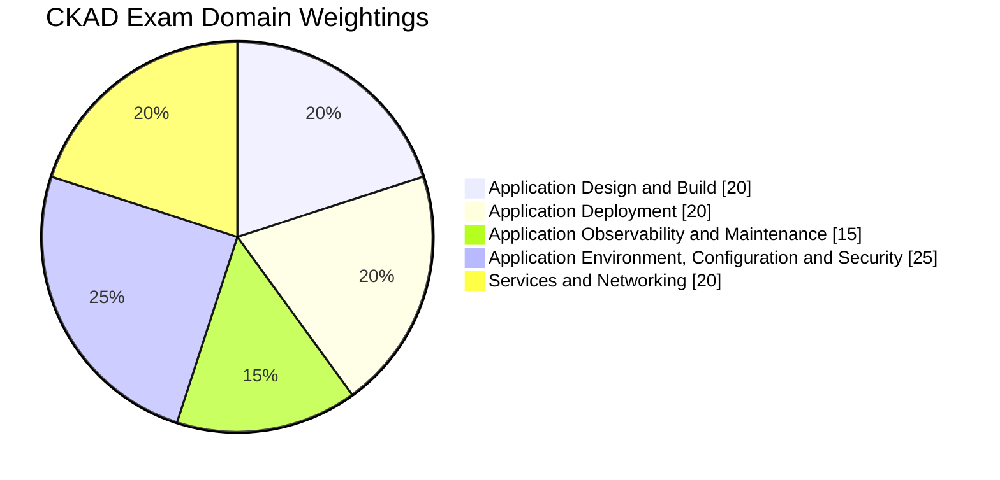
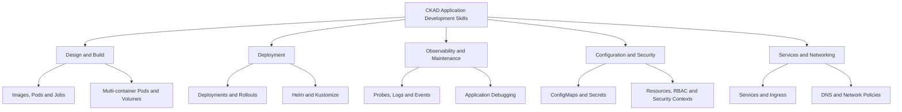
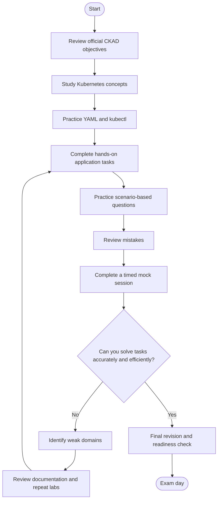
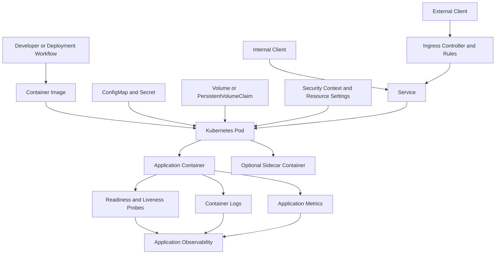
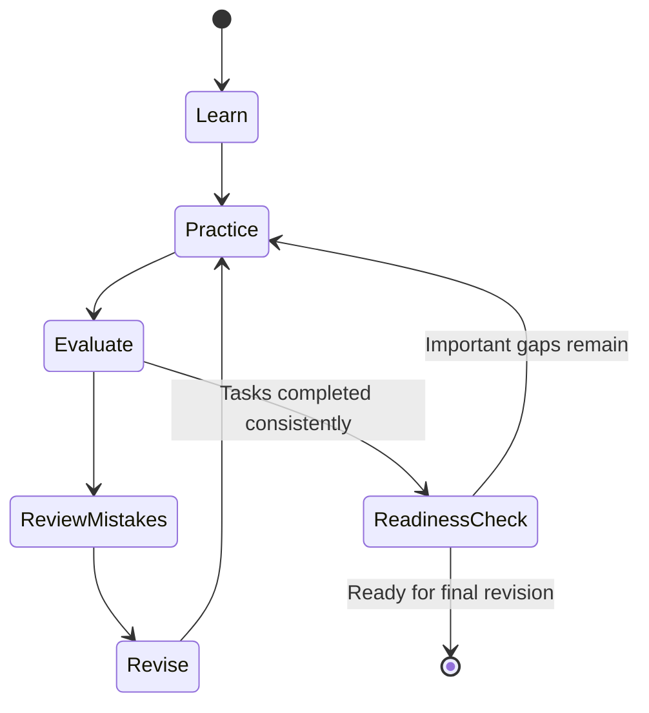
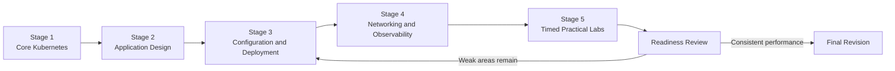
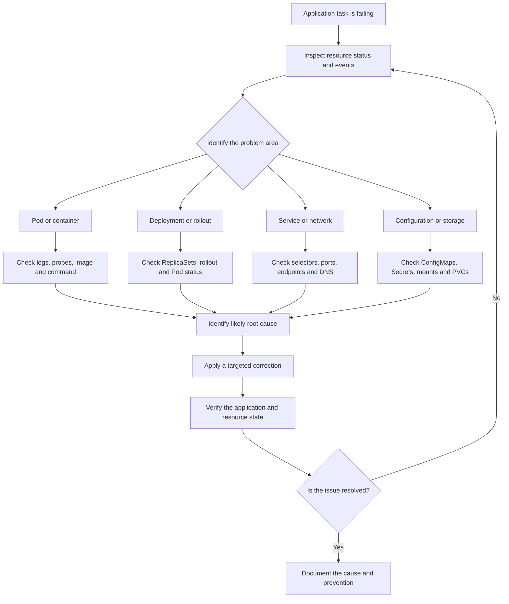

# Certified Kubernetes Application Developer (CKAD) Study Guide

A practical, hands-on preparation guide for the **Certified Kubernetes Application Developer (CKAD)** certification. This repository covers Kubernetes application development, workload configuration, deployment strategies, observability, networking, security, and persistent storage.

CKAD focuses on the ability to define, configure, deploy, expose, monitor, and troubleshoot cloud-native applications running on Kubernetes. The most effective preparation combines understanding Kubernetes resources with repeated command-line practice.

**Additional study resource:** [CertsGate CKAD Preparation](https://certsgate.com/exams/linux-foundation/ckad)

---

## Table of Contents

- [About the CKAD Certification](#about-the-ckad-certification)
- [Who Should Prepare?](#who-should-prepare)
- [Exam Format and Domain Weightings](#exam-format-and-domain-weightings)
- [Official Exam Objectives](#official-exam-objectives)
- [CKAD Preparation Flowchart](#ckad-preparation-flowchart)
- [Kubernetes Application Architecture](#kubernetes-application-architecture)
- [Iterative Study Cycle](#iterative-study-cycle)
- [Step-by-Step Preparation Guide](#step-by-step-preparation-guide)
- [Study Roadmap](#study-roadmap)
- [Hands-On Labs](#hands-on-labs)
- [Practice Questions and Mock Tests](#practice-questions-and-mock-tests)
- [Application Troubleshooting Decision Tree](#application-troubleshooting-decision-tree)
- [Common Preparation Mistakes](#common-preparation-mistakes)
- [Career Relevance](#career-relevance)
- [Frequently Asked Questions](#frequently-asked-questions)
- [Official and Additional Learning Resources](#official-and-additional-learning-resources)
- [About CertsGate](#about-certsgate)

---

## About the CKAD Certification

The **Certified Kubernetes Application Developer (CKAD)** certification is offered through the Linux Foundation and the Cloud Native Computing Foundation (CNCF).

It validates practical skills involved in building, configuring, deploying, and troubleshooting applications on Kubernetes. Rather than focusing primarily on cluster installation and infrastructure administration, CKAD emphasizes the Kubernetes resources and workflows used to run cloud-native applications.

Candidates should understand container images, basic microservice architecture, YAML manifests, and common Kubernetes resources. Experience with a programming language can also help when working with application development, although the exam focuses on Kubernetes application tasks.

### Certification overview

| Item | Details |
|---|---|
| Certification | Certified Kubernetes Application Developer |
| Exam code | CKAD |
| Certification organizations | The Linux Foundation and CNCF |
| Exam type | Online, proctored, performance-based |
| Duration | Approximately 2 hours |
| Exam environment | Kubernetes command-line environment |
| Primary focus | Designing, configuring, deploying, and troubleshooting applications |
| Current published curriculum | See the [official CKAD curriculum](https://github.com/cncf/curriculum/blob/master/ckad/README.md) |
| Official certification page | [Linux Foundation CKAD](https://training.linuxfoundation.org/certification/certified-kubernetes-application-developer-ckad/) |

The official certification information currently identifies Kubernetes v1.35 as the exam environment version. Check the current candidate documentation before your exam because the environment may change.

This repository is an independent study guide, not an official certification publication.

---

## Who Should Prepare?

CKAD is relevant to people who build or operate applications on Kubernetes, including:

- Software developers deploying containerized applications.
- Cloud-native application developers.
- DevOps engineers responsible for application delivery.
- Platform engineers who work with application workloads.
- Cloud engineers managing Kubernetes-based services.
- IT professionals developing practical Kubernetes skills.

Before beginning, become comfortable with the following:

- Basic Linux command-line operations.
- YAML syntax and indentation.
- Container images and container registries.
- Pods, Deployments, and Services.
- Basic networking and HTTP concepts.
- The relationship between application processes and containers.

You do not need to master every Kubernetes feature before starting. A better approach is to learn the fundamentals, then practice each exam domain in a working Kubernetes environment.

---

## Exam Format and Domain Weightings

The current published CKAD curriculum identifies five exam domains. The percentages below are the official curriculum weightings and may be updated as the exam evolves.

| Domain | Weight |
|---|---:|
| Application Design and Build | 20% |
| Application Deployment | 20% |
| Application Observability and Maintenance | 15% |
| Application Environment, Configuration and Security | 25% |
| Services and Networking | 20% |
| **Total** | **100%** |

### CKAD domain weightage chart



The largest domain is Application Environment, Configuration and Security. However, every domain matters, and the percentages do not indicate a guaranteed number of tasks on an individual exam.

### Conceptual skills map

This diagram is an independent study overview, not an additional official exam-weighting model.



Source: [CNCF CKAD Curriculum](https://github.com/cncf/curriculum/blob/master/ckad/README.md)

---

## Official Exam Objectives

Use the current official curriculum as your definitive checklist. The following sections summarize the published CKAD competency areas.

### 1. Application Design and Build — 20%

Focus on creating and structuring Kubernetes workloads.

Study:

- Defining, building, and modifying container images.
- Selecting suitable workload resources, such as Deployments, DaemonSets, Jobs, and CronJobs.
- Multi-container Pod patterns, including sidecar and init containers.
- Persistent and ephemeral volumes.
- Resource labels, selectors, and annotations where relevant to application design.

**Practical target:** Create application resources from YAML, select the right workload type, and explain why the chosen resource fits the task.

### 2. Application Deployment — 20%

Learn how to deploy applications and manage changes safely.

Study:

- Deployments and ReplicaSets.
- Scaling workloads.
- Rolling updates and rollbacks.
- Deployment strategies such as blue-green and canary approaches.
- Helm package management.
- Kustomize overlays and configuration customization.

**Practical target:** Deploy an application, update its image, monitor the rollout, and recover from a failed change.

### 3. Application Observability and Maintenance — 15%

Applications must be healthy and diagnosable after deployment.

Study:

- Readiness, liveness, and startup probes.
- Container logs and resource status.
- Kubernetes events.
- Monitoring application health with command-line tools.
- Debugging failed containers and workloads.
- Recognizing API deprecations and compatible resource definitions.

**Practical target:** Diagnose why a workload is unhealthy and use evidence from status, events, logs, and probes to correct the problem.

### 4. Application Environment, Configuration and Security — 25%

This domain combines application configuration, resource management, and security fundamentals.

Study:

- ConfigMaps and their use in application configuration.
- Secrets and secure handling of sensitive values.
- Environment variables and mounted configuration.
- Requests, limits, and resource quotas.
- ServiceAccounts.
- Authentication, authorization, and admission control concepts.
- SecurityContexts and container capabilities.
- Custom resource definitions (CRDs) and operators.

**Practical target:** Configure an application without unnecessarily embedding settings in its image, apply appropriate resource requirements, and use security controls correctly.

### 5. Services and Networking — 20%

Applications need reliable connectivity and controlled exposure.

Study:

- Kubernetes Services and selectors.
- Service ports and target ports.
- Cluster DNS and service discovery.
- Ingress resources and rules.
- Basic NetworkPolicy concepts.
- Diagnosing application connectivity failures.

**Practical target:** Expose an application through a Service, verify its endpoints, and diagnose a connection that does not reach the intended Pods.

For the full competency list, use the [official CKAD certification page](https://training.linuxfoundation.org/certification/certified-kubernetes-application-developer-ckad/) and the [CNCF CKAD curriculum](https://github.com/cncf/curriculum/blob/master/ckad/README.md).

---

## CKAD Preparation Flowchart

A structured workflow keeps preparation focused on practical skills instead of passive reading.



The key is to connect each learning activity to a practical outcome. If a task fails, determine why it failed before moving to another topic.

---

## Kubernetes Application Architecture

CKAD preparation benefits from understanding how an application moves from its container image to a running Kubernetes workload.

The following diagram is a simplified conceptual example. It is not an official exam architecture.



### How the components relate

| Component | Application development purpose |
|---|---|
| Container image | Packages the application and its runtime dependencies |
| Pod | Provides the Kubernetes execution environment for one or more containers |
| ConfigMap | Supplies non-sensitive configuration |
| Secret | Provides a Kubernetes resource for sensitive configuration data; additional protection depends on cluster configuration and access controls |
| Volume | Makes storage available to containers |
| Deployment | Manages replicated application Pods and rolling updates |
| Service | Provides a stable network endpoint for selected Pods |
| Ingress | Defines HTTP or HTTPS routing through an Ingress controller |
| Probes | Help Kubernetes determine application startup and health |
| Logs and events | Provide diagnostic information when an application fails |

Official references: [Kubernetes Concepts](https://kubernetes.io/docs/concepts/) and [Kubernetes Workloads](https://kubernetes.io/docs/concepts/workloads/).

---

## Iterative Study Cycle

CKAD preparation is not a one-time reading exercise. You should repeatedly create resources, inspect the results, identify errors, and improve your approach.



For each objective, use this cycle:

1. Understand the concept.
2. Build a working example.
3. Modify the configuration.
4. Diagnose an intentional or unexpected failure.
5. Review the documentation.
6. Repeat the task without copying a previous solution.

This process improves both technical understanding and command-line confidence.

---

## Step-by-Step Preparation Guide

### Step 1: Learn core Kubernetes resources

Start with Pods, Deployments, Services, Namespaces, ConfigMaps, Secrets, and volumes.

Understand how resources refer to one another. For example, a Service selects Pods using labels, while a Deployment manages Pods through its template and selector.

Official reference: [Kubernetes Concepts](https://kubernetes.io/docs/concepts/).

### Step 2: Build confidence with `kubectl`

Practice commands for inspecting, creating, updating, and debugging resources.

```bash
kubectl get pods -A
kubectl get deployments -A
kubectl get services -A
kubectl describe pod <pod-name> -n <namespace>
kubectl logs <pod-name> -n <namespace>
kubectl get events -n <namespace>
kubectl explain deployment
kubectl explain pod.spec.containers
```

Use `kubectl explain` to discover supported fields rather than guessing YAML properties. Replace placeholders with actual resource names in your environment.

### Step 3: Practice YAML manifests

Create and modify manifests for:

- Pods and Deployments.
- Jobs and CronJobs.
- Services.
- ConfigMaps and Secrets.
- Probes and resource requirements.
- Multi-container Pods.
- Persistent volume claims.

Learn to identify incorrect indentation, invalid fields, mismatched selectors, missing environment variables, and wrong container ports.

### Step 4: Master application configuration

Practice passing configuration through environment variables and mounted files. Understand when to use a ConfigMap, when a Secret is appropriate, and how changes affect running workloads.

Do not treat a Kubernetes Secret as automatically secure simply because its values are encoded. Review access permissions and the cluster's security configuration.

### Step 5: Learn deployment and release workflows

Deploy an application, scale it, update its image, inspect the rollout, and roll back when necessary.

Explore Helm and Kustomize using the current official documentation. Understand what each tool changes and how to verify the resulting Kubernetes resources.

### Step 6: Practice observability and troubleshooting

Do not limit your labs to healthy applications. Intentionally create a broken image reference, an incorrect Service selector, a failed readiness probe, or a resource configuration that prevents a Pod from scheduling.

Inspect status, events, logs, and the resource specification before applying a fix.

### Step 7: Introduce timed practice

Once the individual tasks are familiar, combine them into short, timed sessions. Practice identifying the requirement, choosing the appropriate resource, applying the change, and verifying the result.

---

## Study Roadmap

This roadmap is an independent preparation recommendation, not an official study schedule. Adapt it to your experience and available time.



| Stage | Main topics | Expected outcome |
|---|---|---|
| 1. Foundations | Pods, Deployments, Services, YAML | Create and inspect basic resources |
| 2. Design and build | Images, Jobs, CronJobs, multi-container Pods, volumes | Build appropriate workload definitions |
| 3. Configuration and deployment | ConfigMaps, Secrets, resource settings, Helm, Kustomize | Configure and update applications |
| 4. Networking and observability | Services, Ingress, probes, logs, debugging | Expose and diagnose applications |
| 5. Practical review | Mixed tasks, timed labs, mock tests | Complete tasks accurately under time constraints |
| Final revision | Weak domains and recurring errors | Confirm practical readiness |

After each stage, record which tasks you can complete independently and which still require documentation or assistance.

---

## Hands-On Labs

The following exercises are independent learning activities. They are not official CKAD exam questions.

### Lab 1: Deploy and scale an application

1. Create a Deployment using a suitable container image.
2. Configure the desired replica count.
3. Expose the workload with a Service.
4. Verify that the Service selects the intended Pods.
5. Update the container image and observe the rollout.
6. Practice a rollback in your disposable lab.

### Lab 2: Configure an application

1. Create a ConfigMap containing a non-sensitive setting.
2. Inject the setting into a Pod as an environment variable or mounted file.
3. Create a Secret for a sample sensitive value.
4. Configure the workload to consume the Secret.
5. Inspect the resulting Pod specification.
6. Review access controls and avoid printing real credentials in logs.

### Lab 3: Build a multi-container Pod

1. Create a Pod with an application container and a sidecar.
2. Configure the containers to share a volume where appropriate.
3. Verify that both containers start successfully.
4. Inspect the logs of each container separately.
5. Investigate how the shared volume is mounted.

### Lab 4: Configure health checks

1. Deploy a simple application.
2. Add an appropriate readiness probe.
3. Add a liveness probe where suitable.
4. Observe Pod readiness and restart behavior.
5. Introduce a controlled probe error.
6. Diagnose the problem and verify the corrected configuration.

### Lab 5: Practice rolling updates

1. Create a Deployment.
2. Update the container image.
3. Inspect the rollout status.
4. Review the ReplicaSets and Pods.
5. Roll back the change.
6. Confirm that the application returns to the expected version.

### Lab 6: Troubleshoot Service connectivity

1. Deploy an application and create a Service.
2. Inspect its selector and target port.
3. Verify the matching Pods and endpoints.
4. Test connectivity from a temporary client Pod.
5. Change the selector in your lab to introduce a failure.
6. Diagnose and correct the mismatch.

### Lab 7: Explore storage and application resources

1. Review the available StorageClasses.
2. Create a PersistentVolumeClaim suitable for your environment.
3. Mount the claim in a workload.
4. Verify that the application can use the mounted path.
5. Inspect the PVC and related events if provisioning fails.

For every lab, document the goal, commands, expected outcome, actual result, root cause of failures, and verification steps.

---

## Practice Questions and Mock Tests

CKAD is performance-based, so use written questions to reinforce understanding rather than replace practical exercises.

The [CertsGate CKAD preparation page](https://certsgate.com/exams/linux-foundation/ckad) can be used as an independent supplementary resource alongside official documentation and hands-on labs.

### Example self-check questions

These are original learning prompts, not official or actual exam questions.

**1. A Pod is running, but the application is not ready. What should you inspect?**

Check the Pod's conditions, readiness probe configuration, container logs, and events. A running container does not necessarily mean that the application is ready to receive traffic.

**2. A Service has no usable endpoints. What should you investigate?**

Check whether the Service selector matches the Pod labels. Then inspect Pod readiness, target ports, namespace, and the relevant endpoint resources.

**3. A Deployment update fails. How do you investigate it?**

Inspect the rollout status, Deployment conditions, ReplicaSets, Pod status, events, and container logs. Look for image-pull errors, invalid configuration, failed probes, or scheduling problems.

**4. An application needs a configurable environment variable. Which Kubernetes resource could help?**

A ConfigMap is appropriate for non-sensitive configuration. A Secret is designed for sensitive configuration data, but access controls and cluster security settings remain important.

**5. A Pod repeatedly restarts after adding a liveness probe. What might be wrong?**

The probe could be misconfigured, target the wrong path or port, or run before the application is ready to respond. Inspect the probe settings, events, and application logs before changing the configuration.

### A reliable practice workflow

Use this process for each question or practical task:

1. Attempt the task without checking the solution.
2. Verify the outcome against the requirement.
3. Explain why the configuration works or fails.
4. Map any mistake to the relevant CKAD domain.
5. Review the official documentation.
6. Repeat a similar task independently.

### How to use mock tests

Use timed sessions to measure how efficiently you can complete tasks, not just how many answers you recognize. After a mock test, identify recurring errors, revisit the relevant concepts, and repeat the practical work before attempting another full session.

Third-party practice materials should be treated as supplementary. Do not assume that practice questions are official exam questions or that memorizing answers demonstrates practical readiness.

---

## Application Troubleshooting Decision Tree

When a workload fails, investigate systematically instead of changing several settings at once.



### Useful diagnostic commands

```bash
kubectl get pods -n <namespace>
kubectl describe pod <pod-name> -n <namespace>
kubectl logs <pod-name> -n <namespace>
kubectl logs <pod-name> -c <container-name> -n <namespace>
kubectl get deployment <deployment-name> -n <namespace>
kubectl rollout status deployment/<deployment-name> -n <namespace>
kubectl get service,endpointslices -n <namespace>
kubectl get events -n <namespace>
kubectl get pvc -n <namespace>
```

Some resources may not exist in every environment, and command permissions depend on your cluster access. Always confirm the active context and namespace before modifying resources.

---

## Common Preparation Mistakes

### Memorizing YAML without understanding it

Copying manifests can help you get started, but it does not prepare you to modify them when requirements change.

**Better approach:** Write manifests from scratch and explain the purpose of each important field.

### Ignoring the application lifecycle

Creating a Deployment is only one step. You must also configure it, expose it, observe its behavior, and troubleshoot failures.

**Better approach:** Follow an application from creation through deployment, health checks, connectivity, and updates.

### Neglecting configuration and security

ConfigMaps, Secrets, resource requirements, ServiceAccounts, and security contexts are all relevant to CKAD.

**Better approach:** Practice these topics as part of real workload configurations rather than studying each only in isolation.

### Practicing only successful scenarios

Healthy applications do not provide enough troubleshooting experience.

**Better approach:** Introduce controlled failures in a disposable environment and learn to identify the root cause.

### Ignoring Helm and Kustomize

Application deployment includes more than manually applying standalone YAML files.

**Better approach:** Learn the basic workflows of both tools and understand how they influence the resources deployed to Kubernetes.

### Using practice questions as the only resource

Recognizing an answer does not prove that you can execute the corresponding task.

**Better approach:** Recreate the underlying scenario in your lab and verify the outcome yourself.

### Skipping final verification

A command may complete successfully while the application remains unhealthy or inaccessible.

**Better approach:** Check resource status, readiness, logs, endpoints, and application behavior after making changes.

---

## Career Relevance

CKAD preparation develops practical skills relevant to several cloud-native roles:

- Kubernetes application developer.
- Cloud-native software developer.
- DevOps engineer.
- Platform engineer.
- Cloud engineer.
- Site reliability engineer working with application workloads.

The certification can provide evidence of Kubernetes application-development competency. Its professional value depends on the role, employer, and how effectively you apply the skills in real projects.

The most durable benefit comes from being able to define resources correctly, deploy applications safely, diagnose failures, and explain your technical decisions.

---

## Frequently Asked Questions

### What is the CKAD certification?

The Certified Kubernetes Application Developer certification assesses practical skills for designing, configuring, deploying, exposing, and troubleshooting cloud-native applications on Kubernetes.

### Is CKAD a practical exam?

Yes. The official exam is online, proctored, and performance-based. Candidates solve tasks using a command-line environment.

### How long is the CKAD exam?

The official certification information currently lists approximately two hours. Check the latest candidate documentation before scheduling.

### Do I need to know Kubernetes cluster administration?

CKAD focuses on application development and workload management rather than the full cluster-administration scope of CKA. Basic Kubernetes architecture and resource knowledge are still important.

### Which CKAD domain deserves the most attention?

Application Environment, Configuration and Security has the largest published weighting at 25%. However, you should practice every domain and use your own performance to identify additional weak areas.

### Are practice questions enough for CKAD preparation?

No single resource should replace practical work. Combine official objectives, Kubernetes documentation, YAML exercises, hands-on labs, and timed practice.

### How can I assess my readiness?

You should be able to complete representative tasks independently, troubleshoot common failures, use documentation efficiently, and verify your changes under time constraints. Practice results are useful indicators, but they cannot guarantee an exam outcome.

### Where can I find the official CKAD objectives?

Start with the [Linux Foundation CKAD certification page](https://training.linuxfoundation.org/certification/certified-kubernetes-application-developer-ckad/) and the [CNCF CKAD curriculum](https://github.com/cncf/curriculum/blob/master/ckad/README.md).

---

## Official and Additional Learning Resources

Use official resources to verify exam requirements and learn Kubernetes behavior.

| Resource | What it provides |
|---|---|
| [Linux Foundation CKAD Certification](https://training.linuxfoundation.org/certification/certified-kubernetes-application-developer-ckad/) | Certification details, competencies, and exam resources |
| [CNCF CKAD Curriculum](https://github.com/cncf/curriculum/blob/master/ckad/README.md) | Current published domains and weightings |
| [Kubernetes Documentation](https://kubernetes.io/docs/home/) | Official technical reference |
| [Kubernetes Workloads](https://kubernetes.io/docs/concepts/workloads/) | Pods, Deployments, Jobs, and related resources |
| [Kubernetes Services and Networking](https://kubernetes.io/docs/concepts/services-networking/) | Service discovery and application connectivity |
| [Kubernetes Configuration](https://kubernetes.io/docs/concepts/configuration/) | Configuration resources and workload settings |
| [Kubernetes Security](https://kubernetes.io/docs/concepts/security/) | Authentication, authorization, and security concepts |
| [kubectl Reference](https://kubernetes.io/docs/reference/kubectl/) | Command syntax and examples |
| [Helm Documentation](https://helm.sh/docs/) | Kubernetes package management |
| [Kustomize Documentation](https://kubectl.docs.kubernetes.io/guides/introduction/kustomize/) | Declarative configuration customization |
| [CertsGate CKAD Resources](https://certsgate.com/exams/linux-foundation/ckad) | Independent supplementary preparation material |

Check that any tutorial or practice lab matches the current curriculum and Kubernetes version relevant to your exam.

---

## About CertsGate

[CertsGate](https://certsgate.com/) provides third-party IT certification preparation resources. Its [CKAD preparation page](https://certsgate.com/exams/linux-foundation/ckad) may complement official documentation, practical labs, and independent review.

Use supplementary practice material to identify gaps in your understanding and revisit the relevant Kubernetes concepts. For the strongest preparation, verify technical details against the official curriculum and reproduce important tasks in a working environment.

CertsGate is referenced here as an independent resource. This repository does not imply an official partnership or endorsement by the Linux Foundation or CNCF.

---
